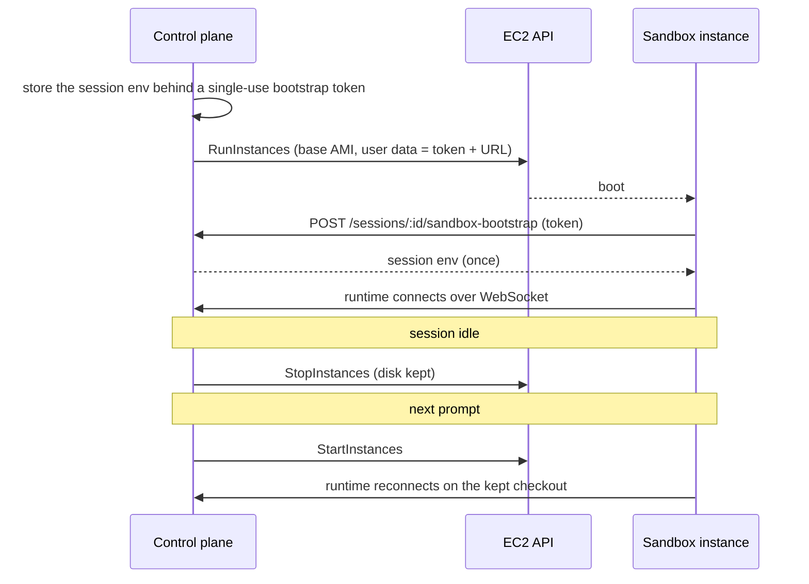

# EC2 Sandbox Provider

Open-Inspect can run each session's sandbox as an EC2 instance in your own AWS account, so the
sandboxes themselves, and the checkouts and secrets they hold, live there. Like any provider's
sandbox, an EC2 sandbox talks to your source-control host, your model provider and any MCP servers
you configure, and it has outbound internet access, so what an agent does with it can leave the
account.

`SANDBOX_PROVIDER=ec2` is supported on the **Node-hosted control plane only** (the
[AWS bring-up](AWS_BRING_UP.md) or any `docker compose` deployment on EC2). The control plane calls
the EC2 API with its own instance role; there is no AWS access key anywhere. The Cloudflare
Terraform environment does not accept `ec2`, and a Cloudflare-hosted control plane configured with
it fails every sandbox launch.

## How it works



- **Launch.** Each session gets its own instance from the base AMI. Its user data carries only the
  bootstrap URL and a token. The environment itself (sandbox auth token, repository secrets, MCP
  configuration) is stored in the session, encrypted, behind that token. The instance's launcher
  redeems it once over HTTPS. The token is single-use, expires after
  `SANDBOX_BOOTSTRAP_TOKEN_TTL_MS`, and only works for the session's current sandbox generation.
  User data, which anyone in the account allowed to describe instance attributes can read, never
  holds the session environment or a long-lived secret. The token itself is a bearer credential
  until it is redeemed, so keep `ec2:DescribeInstanceAttribute` restricted to administrators.
- **Idle and resume.** An idle session's instance is **stopped**. Its disk keeps the checkout, the
  agent's state and the fetched environment, and only the volume is billed. The next prompt starts
  the same instance, and the runtime resumes on the kept checkout without re-running `setup.sh`.
- **Archive.** Archiving a session terminates its instance and deletes its volume.
- **Backstops.** An instance that powers itself off is terminated. The launcher powers off when its
  bootstrap is refused, so a launch that was superseded ends itself. A redemption whose response is
  lost cannot be retried either: the token is already spent, so the launcher's retry is refused and
  the instance ends. The runtime never connects, so the session's connect watchdog marks the sandbox
  failed, and the next spawn (the watchdog's own retry or the next prompt) launches a new generation
  with a fresh token. The launcher also powers off at the session lifetime plus a grace period,
  counted from each boot, so an instance the control plane has lost track of does not run
  indefinitely.

### Not supported (yet)

- Preview URLs: code-server, the web terminal, VNC and tunnel ports. Nothing outside the instance
  can reach its ports.
- Prebuilt repository images. Every session clones and runs `setup.sh` on its first boot.
- Docker inside the sandbox. The base AMI does not install the Docker engine.
- Per-session CPU and memory settings. One instance type serves every session.

## Model keys

The EC2 provider passes no deployment-wide model key to sandboxes. Add the keys for the models you
plan to use (`ANTHROPIC_API_KEY` for Claude, for example) as **global secrets** in Settings ›
Secrets. See [Secrets Management](SECRETS.md).

## Setup with the AWS Terraform environments

The `aws-control-plane` module brings EC2 sandboxes up in two steps, because the base AMI is built
inside the network the first step creates.

1. **Network.** In `terraform/environments/aws-staging` or `aws-production`, set the following and
   apply:

   ```hcl
   ec2_sandboxes = {}
   ```

   This creates a sandbox subnet (public addresses, no NAT gateway), a security group with no
   inbound rules and unrestricted outbound traffic, and an instance profile whose role has no
   permissions. The deployment still runs on its previous provider.

2. **Base AMI.** Build it with the build environment Terraform outputs and credentials that may
   launch instances, create images and write to the media bucket:

   ```bash
   eval "$(terraform output -json ec2_sandbox_image_build_env |
     jq -r 'to_entries[] | "export \(.key)=\(.value)"')"
   npm run sandbox:images -- build --provider ec2 --output /tmp/ec2-image.json
   cat /tmp/ec2-image.json   # {"reference":"ami-..."}
   ```

   The build launches a temporary instance from Canonical's Ubuntu 24.04 AMI and installs the shared
   sandbox image bundle. It bakes in the launcher, then saves the disk as an AMI named
   `openinspect-sandbox-<build hash>`. A second instance then boots from the AMI and runs the image
   verification. Both instances are terminated, including on failure. See
   [packages/ec2-infra](../packages/ec2-infra/README.md).

3. **Switch.** Name the AMI and apply again:

   ```hcl
   ec2_sandboxes = { ami_id = "ami-0123456789abcdef0" }
   ```

   The module writes the `EC2_SANDBOX_*` settings and `SANDBOX_PROVIDER=ec2` to the deployment's
   configuration. It also grants the control plane's role exactly what the provider calls:
   - `RunInstances`, only from that AMI, into the sandbox subnet and security group, with the
     sandbox profile, and only for instances tagged `openinspect:deployment=<deployment name>`.
   - `Start`, `Stop` and `TerminateInstances`, only on instances carrying that tag.
   - `CreateTags`, only as part of `RunInstances`, which tags each instance and volume at launch.
   - `DescribeInstances`.

   Restart the stack for the new configuration to load.

`instance_type` in `ec2_sandboxes` overrides the provider's default instance type
(`DEFAULT_EC2_SANDBOX_INSTANCE_TYPE`) for every sandbox. Raise the account's on-demand vCPU quota
for that instance family to your peak number of concurrent sessions times its vCPUs.

To rebuild the AMI after `packages/sandbox-images`, `packages/sandbox-runtime` or
`packages/ec2-infra` change, run step 2 again and update `ami_id`. Running sessions keep the AMI
they launched from. Deregister an old AMI only once no stopped sandbox you still want to resume was
launched from it.

## Configuration reference

On a Node host configured by hand, set these in `.env`:

| Variable                                 | Required | Meaning                                                                    |
| ---------------------------------------- | -------- | -------------------------------------------------------------------------- |
| `SANDBOX_PROVIDER`                       | yes      | `ec2`                                                                      |
| `EC2_SANDBOX_AMI_ID`                     | yes      | Base AMI built by `packages/ec2-infra`                                     |
| `EC2_SANDBOX_SUBNET_ID`                  | yes      | Subnet sandboxes launch into; it needs outbound internet                   |
| `EC2_SANDBOX_SECURITY_GROUP_ID`          | yes      | Security group for sandboxes; give it no inbound rules                     |
| `EC2_SANDBOX_INSTANCE_PROFILE_ARN`       | yes      | Instance profile ARN; its role should grant nothing                        |
| `EC2_SANDBOX_INSTANCE_TYPE`              | no       | Instance type for every sandbox                                            |
| `EC2_SANDBOX_REGION`                     | yes      | Region to launch in                                                        |
| `EC2_SANDBOX_CONTROL_PLANE_PRIVATE_HOST` | no       | DNS name resolving, inside the VPC, to the control plane's private address |

The control plane's credentials (normally its instance role) need the permissions listed under step
3, plus `iam:PassRole` on the sandbox role. `WORKER_URL` must be `https://`: the bootstrap token and
the session environment travel over it, and the provider refuses to launch otherwise.

Sandboxes reach the control plane at `WORKER_URL`. With `EC2_SANDBOX_CONTROL_PLANE_PRIVATE_HOST`
set, each sandbox resolves that name on every boot and maps `WORKER_URL`'s hostname to the address
it gets, so the traffic stays in the VPC and TLS still verifies the real hostname. The Terraform
module sets it to the AWS public DNS name of the control plane's Elastic IP, which resolves inside
the VPC to the private address of whichever instance holds the Elastic IP, so a replaced
control-plane instance is found again. It also admits the sandbox security group on port 443, so
`ingress_cidrs` can stay a strict allowlist. Without it, sandboxes use the public address and the
allowlist must admit them.

## Security notes

- The agent has `sudo` on its own instance, as on other full-VM providers. It can read the session
  environment it was launched with, which is the same environment its runtime already holds.
- Instances require IMDSv2 with a hop limit of one, so containers the agent starts on their own
  network cannot reach the metadata service. A container on the host network still can, as can the
  agent itself; the instance role has no permissions, so the credentials it hands out grant nothing.
- The bootstrap token in user data is useless once redeemed, and after expiry, and as soon as the
  session launches a newer sandbox.
- Root volumes are encrypted (the AMI is built from an encrypted snapshot) and deleted on
  termination.
